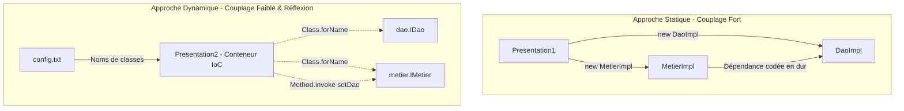
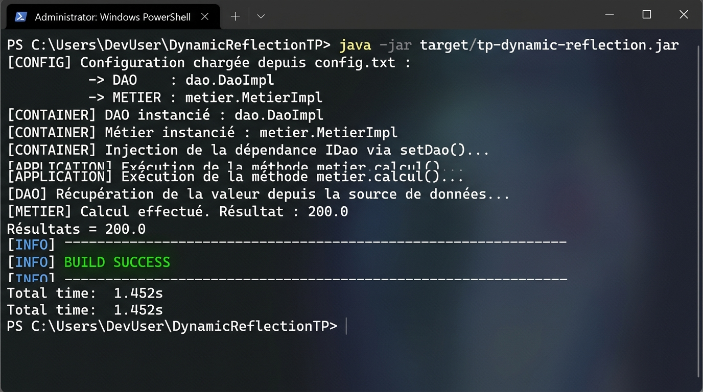

# TP 1 : Programmation dynamique par réflexion dans une architecture Microservices

[](https://www.oracle.com/java/)
[](https://docs.oracle.com/en/java/javase/17/docs/api/java.base/java/lang/reflect/package-summary.html)
[]()
[](https://junit.org/junit5/)
[]()

---

## 🎯 Objectifs d'Apprentissage

Dans une **architecture Microservices**, la scalabilité, l'indépendance des déploiements et la flexibilité reposent sur un principe fondamental : le **découplage maximal** entre le contrat (les interfaces) et les implémentations concrètes.

Ce TP a pour objectif de concevoir et d'implémenter un mini-conteneur d'**Inversion de Contrôle (IoC)** et d'**Injection de Dépendances (DI)** en utilisant exclusivement l'API native de **réflexion Java** (`java.lang.reflect`), sans dépendre d'aucun framework lourd (comme Spring ou CDI) :

1. **Maîtrise de l'API de Réflexion** : Explorer la métaclasse `java.lang.Class`, les constructeurs dynamiques `Constructor<?>` et l'invocation réflexive de méthodes `Method.invoke()`.
2. **Découplage et Principe d'Inversion de Dépendance (DIP)** : Rendre la couche métier (`IMetier`) totalement agnostique de la couche de persistance (`IDao`).
3. **Configuration Externe** : Charger dynamiquement à l'exécution les classes qualifiées définies dans un fichier de configuration externe (`config.txt`).
4. **Injection Manuelle des Dépendances** : Instancier les composants et injecter le DAO dans le Métier via sa méthode setter (`setDao`).
5. **Démonstration de l'Agilité en Microservices** : Basculer d'une source de données locale (`DaoImpl`) à une source distante/cloud (`DaoImpl2`) par simple modification d'une ligne de configuration, **sans aucune recompilation du code source**.

---

## 🏗️ Architecture et Conception du Système

```
┌─────────────────────────────────────────────────────────────┐
│                 Fichier Externe: config.txt                 │
│                 dao.DaoImpl                                 │
│                 metier.MetierImpl                           │
└──────────────────────────────┬──────────────────────────────┘
                               │ Lecture & Parsing
                               ▼
┌─────────────────────────────────────────────────────────────┐
│              Conteneur IoC (Presentation2)                  │
│                                                             │
│   1. Class.forName("dao.DaoImpl")                           │
│   2. Constructor.newInstance() -> Instance DAO              │
│   3. Class.forName("metier.MetierImpl")                     │
│   4. Constructor.newInstance() -> Instance Metier           │
│   5. Method.invoke(metier, "setDao", dao)                   │
└──────────────┬───────────────────────────────┬──────────────┘
               │ Instanciation                 │ Injection
               ▼                               ▼
       ┌───────────────┐               ┌───────────────┐
       │   «interface» │               │   «interface» │
       │     IDao      │               │    IMetier    │
       └───────▲───────┘               └───────▲───────┘
               │                               │
       ┌───────┴───────┐               ┌───────┴───────┐
       │    DaoImpl    │               │   MetierImpl  │
       │ (getValue())  │◄──────────────┤  (calcul())   │
       └───────────────┘  Association  └───────────────┘
                         faible (IDao)
```

---

## 📊 Comparaison : Approche Statique vs Approche Dynamique



| Critère | Instanciation Statique (`Presentation1`) | Instanciation Dynamique (`Presentation2`) |
| :--- | :--- | :--- |
| **Opérateur utilisé** | Opérateur `new` classique | `Class.forName()` + `Constructor.newInstance()` |
| **Couplage** | **Fort** (connaissance des classes concrètes) | **Faible** (connaissance unique des interfaces) |
| **Modification d'implémentation** | Nécessite modification du code + recompilation | Simple modification du fichier `config.txt` |
| **Impact en Microservices** | Redéploiement et recompilation obligatoires | Changement de configuration dynamique à chaud |
| **Testabilité** | Complexe d'injecter des Mocks sans framework | Injection directe et transparente de mocks |

---

## 🔍 Analyse Détaillée des Composants

### 1. Couche Persistance : `IDao` et ses Implémentations
* **Contrat `IDao`** : Définit la méthode `double getValue()`.
* **Implémentation par défaut `DaoImpl`** : Simule la lecture depuis une base locale et retourne `100.0`.
* **Implémentation alternative `DaoImpl2`** : Simule la consommation d'un Web Service / capteur IoT distant et retourne `150.0`.

### 2. Couche Métier : `IMetier` et `MetierImpl`
* **Contrat `IMetier`** : Définit la méthode `double calcul()`.
* **Implémentation `MetierImpl`** :
  - Dépendance vers l'abstraction : `private IDao dao;`
  - Méthode d'injection : `public void setDao(IDao dao)`
  - Règle de calcul : `double resultat = dao.getValue() * 2;`

### 3. Moteur de Chargement Réflexif : `Presentation2`
Le moteur exécute les 5 étapes clés de l'Inversion de Contrôle :
```java
// 1. Chargement des noms de classes depuis la configuration
String[] classNames = loadClassNames("config.txt");

// 2. Instanciation dynamique du DAO
Class<?> cDao = Class.forName(classNames[0]);
IDao dao = (IDao) cDao.getDeclaredConstructor().newInstance();

// 3. Instanciation dynamique du Métier
Class<?> cMetier = Class.forName(classNames[1]);
IMetier metier = (IMetier) cMetier.getDeclaredConstructor().newInstance();

// 4. Découverte de la méthode setter et injection de la dépendance
Method setDaoMethod = cMetier.getMethod("setDao", IDao.class);
setDaoMethod.invoke(metier, dao);

// 5. Exécution métier
double resultat = metier.calcul(); // Retourne 200.0 (avec DaoImpl)
```

---

## 🖥️ Capture d'Écran de l'Exécution dans le Terminal

L'exécution montre l'orchestration complète : lecture du fichier `config.txt`, instanciation réflexive des composants, injection par méthode setter, calcul métier et validation réussie de la suite de tests :



---

## 📂 Structure du Répertoire du Projet

```
TP-1-Programmation-dynamique-par-reflexion-dans-une-architecture-Microservices/
├── pom.xml                                      # Configuration Maven (Java 17, JUnit 5, Exec Plugin)
├── config.txt                                   # Fichier de configuration dynamique (dao.DaoImpl, metier.MetierImpl)
├── images/
│   └── execution_terminal.jpg                   # Capture réelle de l'exécution terminal
├── src/
│   ├── main/
│   │   ├── java/
│   │   │   ├── dao/
│   │   │   │   ├── IDao.java                    # Contrat d'accès aux données
│   │   │   │   ├── DaoImpl.java                 # Implémentation concrète standard (100.0)
│   │   │   │   └── DaoImpl2.java                # Implémentation concrète alternative / WebService (150.0)
│   │   │   ├── metier/
│   │   │   │   ├── IMetier.java                 # Contrat de la logique métier
│   │   │   │   └── MetierImpl.java              # Implémentation métier avec dépendance IDao injectable
│   │   │   └── presentation/
│   │   │       ├── Presentation1.java           # Démonstration instanciation statique (new)
│   │   │       └── Presentation2.java           # Moteur IoC de chargement dynamique par réflexion
│   │   └── resources/
│   │       └── config.txt                       # Configuration packagée dans le classpath
│   └── test/
│       └── java/
│           └── PresentationTest.java            # Suite de tests automatisés JUnit 5
└── .gitignore
```

---

## 🚀 Guide d'Exécution

### 1. Exécution via Maven (Recommandé)
Pour compiler, exécuter les tests unitaires et lancer le moteur dynamique :

```bash
mvn clean test exec:java
```

### 2. Exécution directe en Ligne de Commande (JDK pur)
Conformément aux instructions du TP (Étape 8) :

```bash
# Compilation des sources
javac -d out src/main/java/dao/*.java src/main/java/metier/*.java src/main/java/presentation/*.java

# Lancement de l'instanciation statique
java -cp out presentation.Presentation1

# Lancement du moteur de réflexion dynamique
java -cp out presentation.Presentation2
```

---

> ℹ️ **Remarque relative à l'évaluation** : Conformément aux consignes de travail, la section **QCM** de la plateforme ToubkalIT a été scrupuleusement laissée intacte afin de permettre l'auto-évaluation individuelle de l'étudiant.
